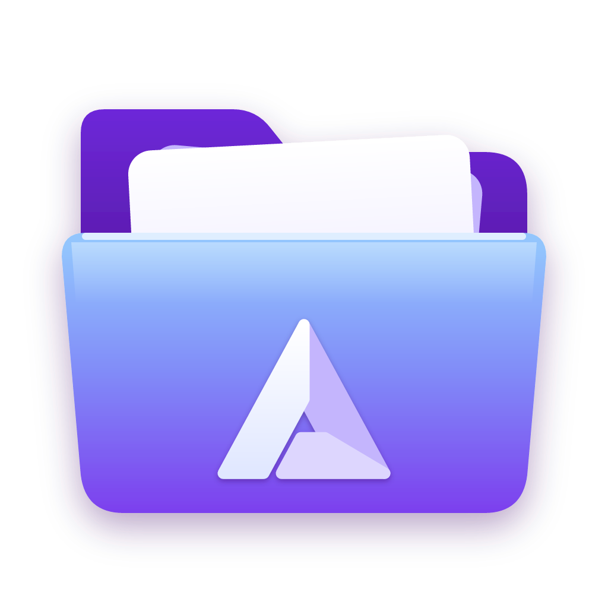
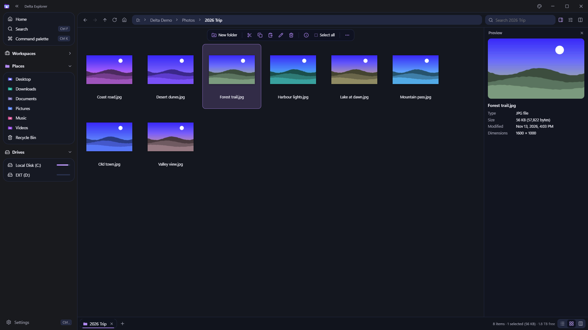
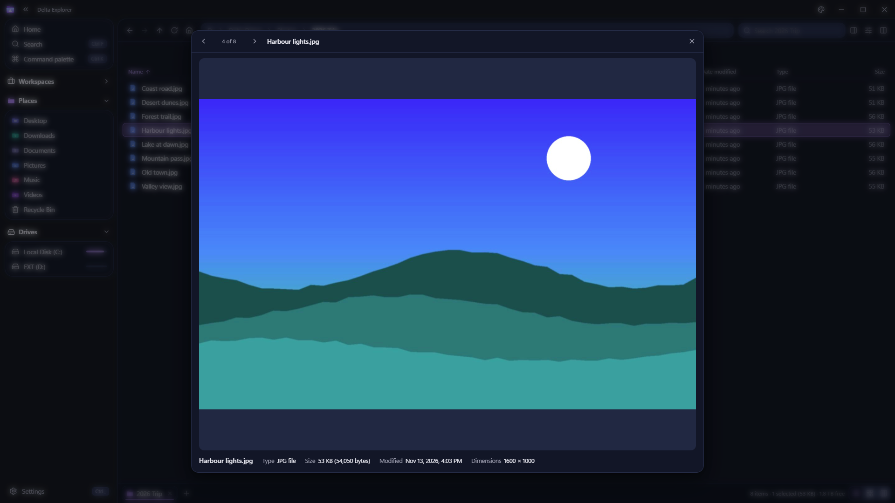
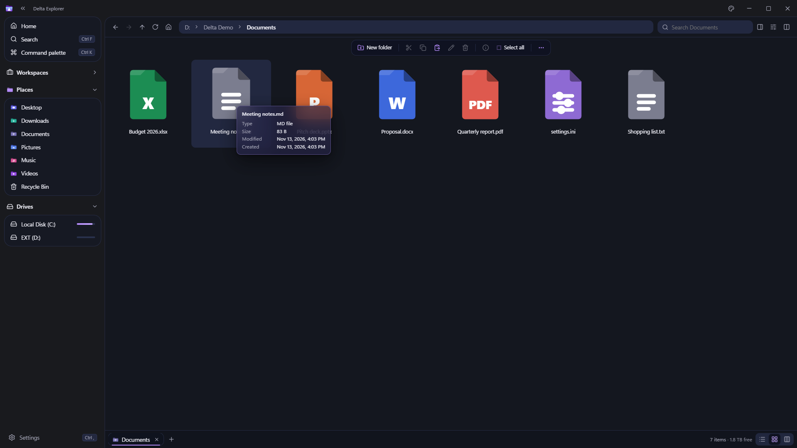
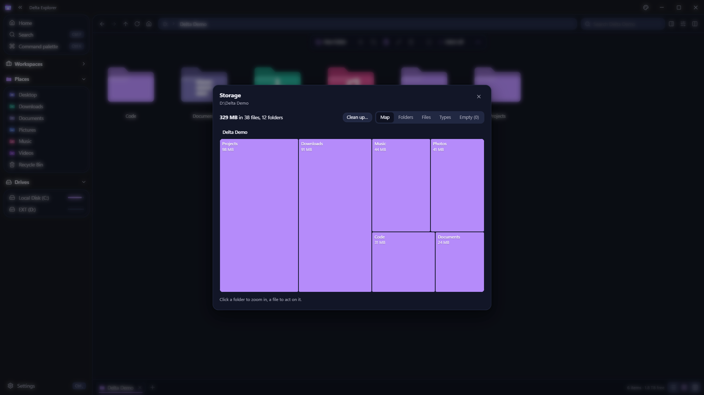
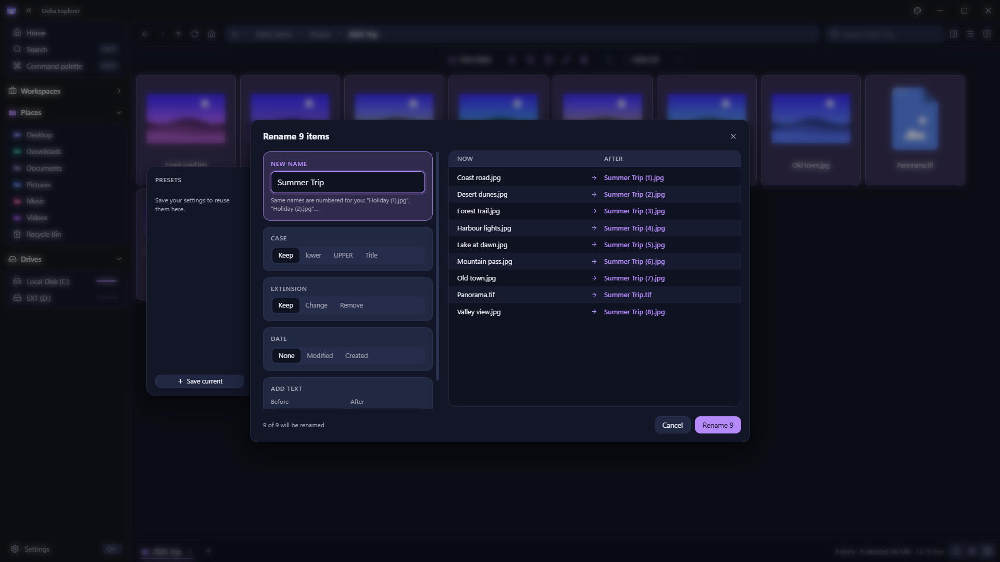
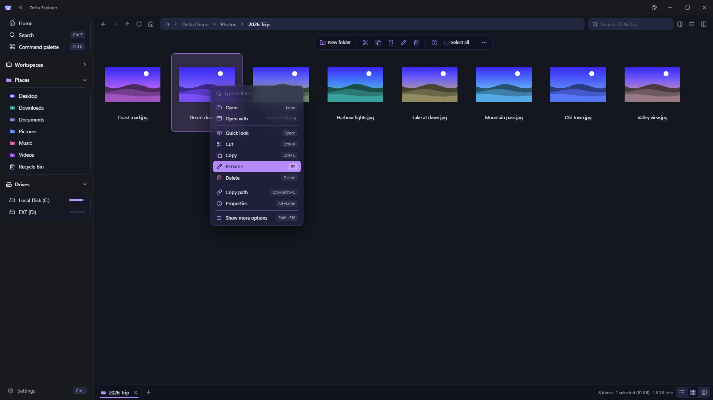
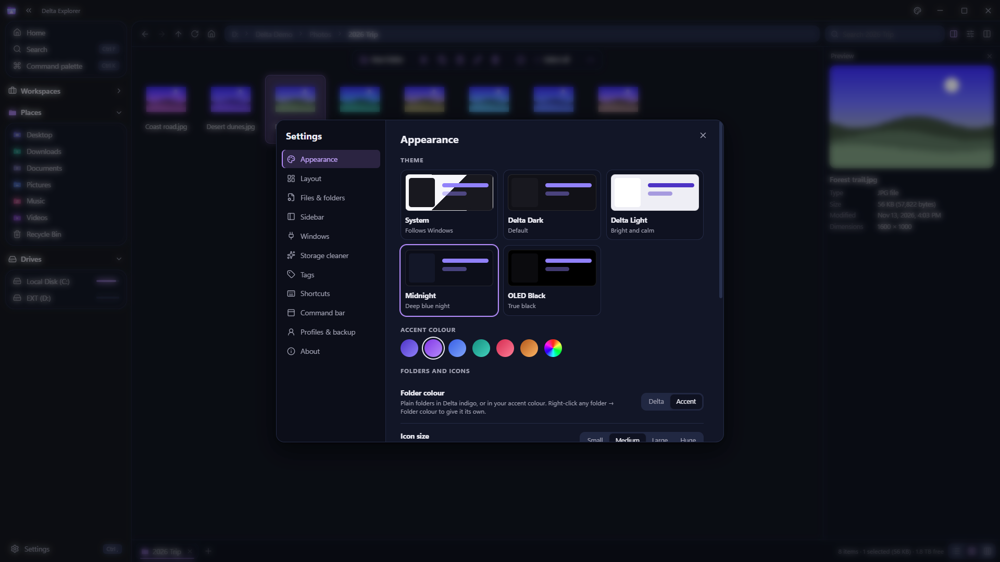
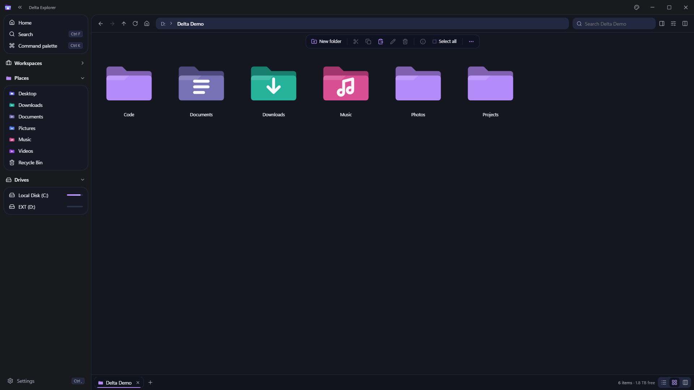

<div align="center">



# Delta Explorer

**A fast, beautiful file manager for Windows 11.**
Everything File Explorer does, plus previews, archives, storage tools and deep personalisation, on a Rust core that opens 50,000-file folders in milliseconds.

[](#install)
[](#how-its-built)
[](#how-its-built)
[](#how-its-built)
[](LICENSE)



</div>

## Why Delta?

- **Fast where it matters.** Listing, sorting, searching, copying and compressing all run in native Rust; the UI only draws what's on screen.
- **Nothing to relearn.** Tabs, breadcrumbs, the Windows clipboard, drag and drop, the Recycle Bin and your apps' right-click entries work like they do in File Explorer.
- **The tools you'd otherwise install separately:** previews, 7-Zip-style archives, batch rename, duplicate finder, storage map, folder sync, SFTP.
- **Yours to style.** Themes, any accent colour, folder colours, icon sizes, background pictures, see-through windows.

---

## Everything a file manager should do

| | |
|---|---|
| **Browse** | Tabs, split view, multiple windows, back/forward that remembers scroll and selection, breadcrumbs, a smart address bar (quoted paths, `%USERPROFILE%`, `/` slashes, shortcuts), and a Home page with drives and recent files |
| **Views** | Grid, list (details) and Miller columns; choose, resize and reorder columns; group by date, type, size or name; folder sizes; hover info cards |
| **Files** | Copy, cut and paste through the real Windows clipboard, so it works with File Explorer, Discord, mail and more; drag in and out of other apps; new folder; rename (`Name (1)` when taken); Recycle Bin and permanent delete; undo |
| **Find** | Type-to-jump, filter box, recursive search, select by pattern (`*.png`), invert selection |
| **Windows integration** | Your apps' right-click entries (7-Zip, VS Code, Git, Defender…), Open with, Properties, Share, Send to, Create shortcut, Open in Terminal / PowerShell / CMD, a **Win + E** replacement, start with Windows, a global hotkey |
| **Safety** | Busy jobs run in the background with progress and cancel; a "file already exists" dialog with Replace / Skip / Keep both / Compare; replaced files go to the Recycle Bin; per-operation **Try as administrator** without running the whole app elevated |

## What makes Delta different

<table>
<tr>
<td width="50%"></td>
<td width="50%"></td>
</tr>
<tr>
<td><b>Quick Look and preview pane.</b> Press <kbd>Space</kbd> for a full-size preview, or <kbd>Alt</kbd>+<kbd>P</kbd> for a side pane: photos, SVG, code with syntax colours, PDF, video, audio with its own player, fonts and archive contents.</td>
<td><b>Icons for everyday file types</b> drawn in the same style as the folders (text, config, DLL, scripts, Office, PDF, media, code…) and <b>hover cards</b> with size, dates, dimensions and length.</td>
</tr>
<tr>
<td></td>
<td></td>
</tr>
<tr>
<td><b>Storage analyser.</b> A treemap of what's using your space, the largest files and folders, a type breakdown and empty folders, plus a <b>storage cleaner</b> for temp files, old Recycle Bin items and old downloads (always previewed, undoable).</td>
<td><b>Batch rename.</b> Type one name and every file is numbered for you. Change case, extension, add a date or extra text, and save presets. Live preview, one undo.</td>
</tr>
</table>

**Also built in:**

- **Archives.** Open zip, 7z, RAR, tar, gz, bz2 and xz like folders; extract here, to a folder or to `Name\`; compress folders to zip, 7z or tar.gz with a password and level. Half-written archives never appear, and zip bombs are refused.
- **Duplicate finder.** Hash-based matching, "keep newest/oldest", Recycle Bin only.
- **Folder compare & sync.** One-way, both ways or mirror. You always see the plan first, and deletions go to the Recycle Bin.
- **File compare** (side-by-side text diff), **checksums** (MD5 / SHA-1 / SHA-256), and **photo EXIF and music tag** viewing and editing.
- **Git awareness.** The branch in the status bar, plus badges for modified, new and ignored files.
- **Drop Zone shelf** to park files while you navigate, **Collections** (virtual folders of files from anywhere), **Tags**, pinned folders and **Workspaces** (saved tab sets).
- **Remote folders.** SFTP, FTP/FTPS and WebDAV browse like local ones; passwords stay in Windows Credential Manager.
- **Command palette** (<kbd>Ctrl</kbd>+<kbd>K</kbd>) for every action, a **shortcut editor**, and a **customisable command bar**.

<div align="center"></div>

**A right-click menu that stays short.** The first menu has only the everyday items. **Show more options** opens Delta's second menu, grouped into Organise, Tools, Copy and Open in, with every entry your installed apps add to Windows under **Windows & apps**, drawn in Delta's own style.

## Performance

Delta keeps the slow work out of the interface: Rust does all file access on background threads, and the UI asks for one page of results at a time.

| Measured on this build | Result |
|---|---|
| List and sort a folder of **50,000 files** (release build) | **59 ms** |
| Compress 1.5 GB + 5,000 text files to zip: one core, standard level → Delta's default | **30.7 s → 1.8 s** |
| Rows drawn for a folder of any size | Only the visible ones (virtualised list) |

- **Parallel compression** uses every CPU core and *stores* files that won't shrink (photos, video, other archives) instead of wasting time on them.
- **Folder sizes, thumbnails and media details** are fetched in the background and cached, so scrolling never waits on them.
- **Live refresh.** A file watcher updates open folders as things change; bursts like a 500-file copy collapse into one refresh.
- **Smooth scrolling** everywhere in the app, instead of Windows' step-by-step wheel jumps.

Re-run the speed test yourself: `cargo test --release -p de-core --test sim -- --ignored s38 --nocapture`.

## Customisation

<div align="center"></div>

- **Themes:** System, Delta Dark, Delta Light, Midnight, OLED Black.
- **Accent colour:** presets or any colour from the colour wheel. Folders can follow your accent.
- **Per-folder colours:** right-click a folder → Folder colour. Pinned folders keep their colour in the sidebar.
- **Background picture** with crop, zoom, position, strength and blur; file names stay readable on top.
- **Window:** see-through opacity with Mica or Acrylic blur, UI scale, density and icon size (Small to Huge).
- **Layout:** sidebar side and section order, one layout everywhere or remembered per folder, named view profiles.
- **Shortcuts and command bar:** rebind any key, and add, remove or reorder command-bar buttons.
- **Profiles and backup:** export all your settings to a file and import them on another PC, or switch between named profiles.

<div align="center"></div>

## Keyboard shortcuts

| Action | Keys | | Action | Keys |
|---|---|---|---|---|
| Command palette | <kbd>Ctrl</kbd>+<kbd>K</kbd> | | Quick Look | <kbd>Space</kbd> |
| New tab / close / reopen | <kbd>Ctrl</kbd>+<kbd>T</kbd> / <kbd>W</kbd> / <kbd>Shift</kbd>+<kbd>T</kbd> | | Preview pane | <kbd>Alt</kbd>+<kbd>P</kbd> |
| New window | <kbd>Ctrl</kbd>+<kbd>N</kbd> | | Rename / batch rename | <kbd>F2</kbd> |
| Address bar | <kbd>Alt</kbd>+<kbd>D</kbd> or <kbd>Ctrl</kbd>+<kbd>L</kbd> | | Delete permanently | <kbd>Shift</kbd>+<kbd>Del</kbd> |
| Go to tab 1–9 | <kbd>Ctrl</kbd>+<kbd>1</kbd>…<kbd>9</kbd> | | Invert selection | <kbd>Ctrl</kbd>+<kbd>I</kbd> |
| Search | <kbd>Ctrl</kbd>+<kbd>F</kbd> | | Settings | <kbd>Ctrl</kbd>+<kbd>,</kbd> |

Every shortcut can be changed in **Settings → Shortcuts**.

## Install

Download the latest installer from **[Releases](../../releases)** and run it. It installs for your user only, with no admin rights needed.

Requires Windows 10 or 11 with the WebView2 runtime, which ships with Windows 11.

### Build from source

You need [Rust](https://rustup.rs) (MSVC toolchain), [Node.js](https://nodejs.org) 22+, [pnpm](https://pnpm.io) and the Visual Studio C++ Build Tools.

```bash
pnpm install
```

```bash
pnpm tauri dev
```

```bash
pnpm tauri build
```

The installer lands in `target/release/bundle/nsis/`.

### Tests

```bash
cargo test --workspace
```

```bash
node --test tests/
```

The Rust suite includes about 40 real-world scenarios run against scratch folders: pasting twice, locked files, cancelled copies, unplugged destinations, long paths, Unicode names, corrupt and malicious archives, and same-size file compares.

## How it's built

| Part | What it does |
|---|---|
| `crates/de-core` | Pure Rust: listing, sorting, search, copy/move, rename, archives, compare/sync, duplicates, storage scan, cleaner rules |
| `crates/de-shell` | Windows integration through the `windows` crate: clipboard, Recycle Bin, shell menus, thumbnails, icons, Share, shortcuts |
| `crates/de-remote` | SFTP, FTP/FTPS and WebDAV providers behind one interface |
| `src-tauri` | A thin Tauri 2 command layer, background jobs and the file watcher |
| `src` | The React 19 + TypeScript interface |
| `branding` | The logo and icon sources; `pnpm brand` rebuilds every icon size |

Design notes and the benchmarks behind the stack choice are in [docs/ARCHITECTURE.md](docs/ARCHITECTURE.md).

## Status

Delta Explorer is in **early release (0.1)**. Everyday browsing and file operations are well tested. A few areas still need more real-world use before they can be called stable: remote servers (SFTP/FTP), dragging tabs between windows, administrator operations and mirror sync. Please report issues.

## License

[MIT](LICENSE) © Delta Projects
